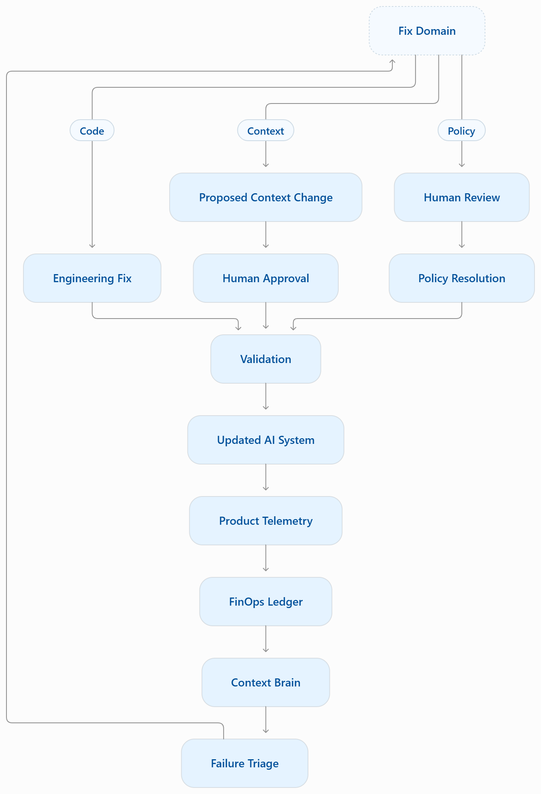
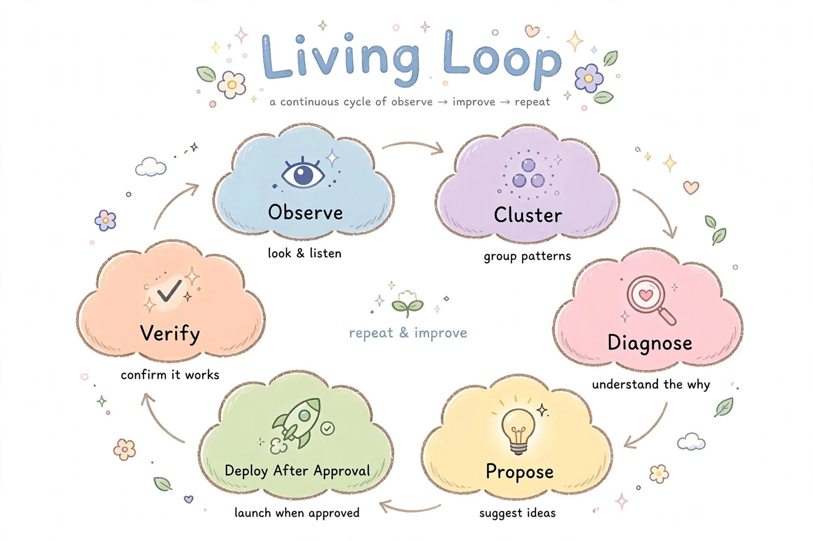

# AegisLoop : The Living Loop

### AI FinOps × Self-Healing Context × Product Telemetry

**AI systems don't just waste money when models are expensive. They waste money when bad outputs create more work.**

Bad context → Bad output → Human edits and retries → More tokens → Higher costs.

**AegisLoop connects these failures into one continuous improvement loop.**

It helps teams identify why AI systems fail, determine whether the fix belongs in code, context, or business policy, and propose evidence-backed improvements.

---

## The Problem : Three Broken Silos

- **AI FinOps:** Tracks token usage and spending but struggles to explain the root cause of waste.
- **Context Engineering:** Adds instructions and business rules, often without knowing which ones actually improve accuracy.
- **Product Telemetry:** Tracks edits, retries, and abandoned outputs but rarely connects them to actionable fixes.

**AegisLoop connects all three:** Product behavior reveals failures, cost data quantifies their impact, and context analysis helps identify the cause.

---

## AegisLoop Architecture

The following diagram shows how AegisLoop identifies failures, routes them to the appropriate fix domain, validates improvements, and feeds the updated AI system back into the loop.


## Fix Domains

| **Fix Domain** | **What It Means** |
|---|---|
| **Code** | Fix broken tools, retrievers, or application logic. |
| **Context** | Identify and suggest missing or incorrect business rules. |
| **Policy** | Send conflicting definitions to a human owner for a decision. |

---

## The Living Loop

1. **Observe:** Capture user edits, retries, abandoned outputs, and other product events.
2. **Measure:** Connect failure patterns to token usage and AI operating costs.
3. **Diagnose:** Analyze context, application behavior, and business rules to identify likely causes.
4. **Triage:** Classify each issue as a code, context, or policy problem.
5. **Propose:** Generate evidence-backed fixes for engineering review or human approval.
6. **Validate:** Test proposed changes against relevant examples and quality checks.
7. **Improve:** Deploy approved changes and monitor whether accuracy improves and unnecessary costs decrease.

The updated system generates new product telemetry, allowing the cycle to continue.

---

## The Goal

**Don't just track AI costs. Understand what causes them, fix the underlying problems, and measure whether those fixes work.**

AegisLoop brings AI spending, product behavior, and system improvement into one continuous feedback loop.
    

Metrics That Matter
-------------------

*   **CPST:** Cost per successful task.
    
*   **Waste Ratio:** Share of AI spending associated with defined waste events.
    
*   **Context ROI:** Accuracy improvement relative to additional context tokens.
    
*   **MTTCH:** Mean Time to Context Healing.
    
*   **Context Coverage:** Share of queries for which retrieved context proves useful.
    

Implementation Stack
--------------------

| **Layer** | **Proposed Technology** |
|---|---|
| Telemetry | OpenTelemetry + Langfuse / LangSmith |
| FinOps | ClickHouse + dbt |
| Context | Markdown, YAML, Qdrant / Weaviate |
| Diagnosis | LLM-assisted failure triage |
| Workflow | GitHub Actions + reviewed pull requests |

_These are proposed integration choices, not claims that every integration is already implemented._

Privacy and Governance
----------------------

*   Avoid storing raw prompts and personally identifiable information in telemetry.
    
*   Analyze aggregated failure patterns rather than individual employee performance.
    
*   Require human approval for proposed fixes.
    
*   Assign every context rule an owner and a review date.
    
*   Escalate ambiguous business definitions instead of attempting to solve organizational disagreements with prompts.
    

Current Status
--------------

AegisLoop is being developed as a deterministic, offline simulation of AI cost optimization, context ablation, product telemetry, and feedback-driven diagnostics.

Its current benchmark results are modeled outputs, not verified production savings. Live integrations, real-world validation, and automated pull-request workflows remain future development directions.

The Vision
----------

**Don't just monitor AI failures. Build a system that learns from them.**

AegisLoop aims to help teams make AI systems more cost-efficient, accurate, and reliable through measurable, reviewable improvements.

**Built in public. Open to feedback and contributions.**

If you're building AI systems for real-world business workflows, explore the project, share your feedback, and contribute.

That question is why I designed and added the fourth pillar from my own side: **The Living Loop**.

> **An upfront honesty note on the numbers:** Every figure in this repo (the 83.2% drop in monthly token spend, the 35% → 95% SQL accuracy jump, and the 160.8 → 22.5 drop in manual effort) comes from a deterministic **simulated enterprise benchmark dataset** I seeded so you can clone this repo and run the entire control plane locally with zero API keys. Treat them as a reproducible testbench showing how the loop behaves, not a live production billing statement. See [Honest limitations, why I refuse to score people & what's next](#honest-limitations-why-i-refuse-to-score-people--whats-next) below.

## Quickstart

```bash
npm install
npm run dev      # launch the interactive control plane → http://localhost:5173
npm test         # run all 39 deterministic engine assertions (vitest)
npm run build    # strict type-check (tsc --noEmit) + production Vite bundle
```

Zero API keys, zero GPU, zero network calls at runtime — the entire simulation (12 enterprise AI workflows, 20 Text-to-SQL benchmark traps, 10 context rules, 120 user sessions, and 52 hand-typed prompt overrides) runs locally and reproducibly in your browser.

## The Four Steps (And Why I Added the Fourth)

| Step | Pillar | Role in the System | How I Approached It |
| --- | --- | --- | --- |
| 1 | Token FinOps & ROI-Aware Routing | Technical mechanism | Connects team token spend to actual verified outcomes, then routes low-complexity prompts off expensive frontier models onto quantized 8B models and a semantic cache. |
| 2 | Data Analyst AI Agent & Context Ablation | Technical mechanism | Feeds business rules into a Text-to-SQL agent and uses leave-one-out Shapley ablation to measure how much accuracy each rule actually buys per 100 tokens. |
| 3 | AI Product Telemetry & Edit Forensics | Technical mechanism | Tracks how often humans have to edit, regenerate, or abandon AI outputs, and puts a hard dollar figure on the tokens burned inside retry loops. |
| 4 | **The Living Loop** — Diagnostic & Remedy Framework | Diagnostic philosophy (My Addition) | My own diagnostic layer: a systems-and-biobehavioral method to diagnose *new* failure modes, separate one person's style quirk from a company-wide bug, and keep human accountability with humans. |

### What Step 4 (The Living Loop) adds on top of Steps 1–3

Steps 1 to 3 are the technical "how." They work well once you already know what your failure buckets are. Step 4 is the diagnostic "why and when" — how I figure out where an AI system is failing in the wild and what kind of remedy actually fits:

- **Speed (signal freshness):** A mistake only teaches while its context is still warm. Every session tracks `signalCaptureLatencySec` — the gap between "the output was wrong" and "the system captured the correction."
- **Reward, not pain:** An AI doesn't have a body, so pain or punishment is the wrong mental model. Instead, every session asks a simpler question: *was the output good, full, and complete?* That maps to a reward score `R ∈ [0, 1]` (`1.0` when accepted as-is, `1.0 − editDistance` when edited, `0.0` when abandoned). A missing "yes" is enough to tell the system to try a different context patch next time.
- **Multi-function growth (two-factor rule survival):** In biology, organs earn their keep by serving more than one function. I treat prompt rules the same way: a rule only earns permanent residency in the global prompt if it helps across multiple query patterns (≥ 2 templates) — *unless* it's a strict factual guardrail (like "our fiscal year starts February 1"). Pairing my structural check with Step 2's empirical Shapley math gives two independent defenses against prompt bloat: `retain_core`, `audit_dormant`, `scoped_guardrail`, and `prune_bloat`.
- **Symptom-vs-cause diagnosis:** If an agent gets Q1 revenue wrong and you hardcode that one number, you fixed a symptom. If you add the company's fiscal calendar and currency-join conventions as one rule, you fixed the cause. My rule of thumb is testable: a cause-level fix prevents ≥ 2 distinct correction patterns (`remediationBreadthCount >= 2`); a symptom fix prevents 1 and gets held back for refactoring.
- **The 10× repetition trigger:** When someone types the same guardrail into the prompt box by hand ≥ 10 times, the system notices. If only **1 person** is doing it (say, preferring lowercase SQL aliases), it offers to save it to their **personal profile memory** so we don't pollute the global prompt for everyone else. If **≥ 3 people** are typing the same workaround, it escalates to a steward as an **org-wide context patch candidate**.
- **Manual Effort Index (MEI) as the real headline metric:** Accuracy percentages look great in a benchmark notebook, but in production nobody has pre-written ground-truth SQL for every ad-hoc question. So I measure success by how much manual work the human still has to do: `edits + regenerations + hand-typed overrides per 100 sessions`.
- **Humans own outcomes (two layers, zero surveillance):** Not every problem belongs in software. My **Software Layer** catches edits, clusters retries, and prunes dead rules; the **Human Policy Layer** handles silent dissatisfaction via a quick end-of-session check (*"Was this good, full, and complete?"*). Above all, **AegisLoop never scores, ranks, or judges employees.**

## How I Wired the Architecture

```
┌────────────────────────── src/data (deterministic seeds) ─────────────────────────┐
│ enterpriseSeed.ts    12 workflows · 5 departments · 4 model tiers                  │
│ sqlBenchmarks.ts     20 Text-to-SQL cases · 10 rules (5 core / 3 patch / 2 bloat,  │
│                      680 prune-bloat tokens) + Step 4 structural metadata         │
│ telemetryLogs.ts     120 sessions (seeded mulberry32) · reward & latency signals ·  │
│                      edit-diff library · 52 hand-typed instruction events         │
└──────────────┬───────────────────────────┬─────────────────────────┬────────────────┘
               │                           │                         │
┌──────────────▼─────────┐  ┌──────────────▼────────────┐  ┌─────────▼─────────────┐
│ tokenFinOpsEngine.ts   │  │ contextAblationEngine.ts │  │ productTelemetry-    │
│ routing, semantic      │  │ benchmark pass/fail,     │  │ Engine.ts            │
│ cache, ROI math        │  │ Shapley LOO gains,       │  │ funnel, cost-of-     │
│                        │  │ token overhead            │  │ recovery, clustering │
└──────────────┬─────────┐  └──────────────┬────────────┘  └─────────┬─────────────┘
               │                           │                         │
               └──────────────┬────────────┴─────────────┬───────────┘
                              ▼                            ▼
     ┌────────────────────────────────────┐  ┌──────────────────────────────────┐
     │ livingLoopDiagnosticEngine.ts      │  │ closedLoopAutopilot.ts           │
     │ symptom-vs-cause breadth test,     │  │ promote patches · prune bloat ·  │
     │ repetition triggers, dual rule     │  │ enable cache/prune · return the  │
     │ survival, MEI + reward signals      │  │ before/after cycle summary       │
     └────────────────────────────────────┘  └──────────────────────────────────┘
                              ▼
        React 18 + Vite + Tailwind control plane (4 tabs, KPI ribbon,
        autopilot toggle, Seeded Demo Dataset badges)
```

## The Math Under the Hood (Exact, Division-Safe, Test-Locked)

- `grossValueUsd = outcomes × hoursSaved × loadedWage + directRevenue`
- `netRoiRatio = (grossValue − spend) / max(spend, 0.01)`
- `costPerVerifiedOutcome = spend / max(1, outcomes)`
- Routing: `complexity < flashThreshold → quantized 8B`; `< frontierThreshold → flash`; else frontier ($15/$60 per 1M tokens)
- Cache: billed volume drops by `hitPotential × 0.85`; cache lookups billed at $0.10/1M
- `efficiencyPer100Tokens = marginalAccuracyGain / tokenWeight × 100`
- `MEI = (manualEdits + regenerations + handTypedOverrides) / sessions × 100`
- Reward: `R = 1.0` accepted · `R = 1.0 − editDistance` edited · `R = 0.0` rejected
- Annualized savings = (FinOps routing savings + recovered retry-loop spend) × 12

## What Happens When I Flip the Autopilot On (Simulated Benchmark Outputs)

| Metric | Unoptimized Baseline | Closed-Loop Autopilot |
| --- | --- | --- |
| Monthly token spend (12 workflows) | **$12,937.96** | **$2,179.27** (−83.2%) |
| Net ROI multiplier | ×151.1 | ×902.1 |
| SQL benchmark accuracy | 35% raw → 70% static context | **95%** |
| Prompt overhead per query | 930 tok | 435 tok (680 bloat pruned) |
| **Manual Effort Index (per 100 sessions)** | **160.8** | **22.5** (−86%) |
| Reward completeness (avg R) | 0.65 | 0.91 (full-reward share 41.7% → 85.0%) |
| Product edit / regeneration rate | 58.3% / 55.0% | 15.0% / 11.7% |
| Cost per accepted output | $0.612 | $0.280 |
| Annualized enterprise savings | — | **$129,467** |

## Walking Through the 4-Tab Control Plane

1. **Token FinOps & Adaptive Router (Step 1)** — drag the complexity-threshold sliders (with automatic cross-clamping so you can't invert the tiers), flip the semantic cache and bloat-pruning toggles, and inspect the 12-workload routing ledger to see which burning Frontier workloads get demoted to Flash or Quantized 8B.
2. **Data Agent Lab & Context Ablation (Step 2)** — toggle any of the 10 context rules on or off and watch SQL accuracy (35% → 70% → 95%) and prompt token overhead recompute live. Every rule row shows both its empirical leave-one-out Shapley efficiency and its Step 4 structural survival verdict, alongside a 20-case SQL diff inspector (including `sql_020`, which I intentionally left open for iteration 2 so the loop doesn't pretend to hit a fake 100%).
3. **Product Telemetry & Edit Forensics (Step 3)** — breaks down the 120 sessions into an acceptance funnel, a productive-vs-wasted cost waterfall, a surface-by-surface table, side-by-side agent-vs-human edit diffs, and the top high-friction session log.
4. **The Living Loop & Synthesis (Step 4)** — walks through my 6-step diagnostic cycle (`Notice → Cluster → Find Root → Propose → Prune → Confirm`) with live numbers, the **Repetition Trigger & Preference Filter table** (showing why a 12× single-user date habit goes to personal memory, why a 13× multi-user soft-delete fix goes to global context, and why a 6× pattern stays quiet below the threshold), the **Two-Layer Governance panel**, the **Non-Surveillance Ethics Pledge**, and a one-click case study export.

## Honest Limitations, Why I Refuse to Score People & What's Next

- **Simulated, not production:** Every financial and accuracy number in this repo comes from a deterministic seeded dataset I built for offline reproducibility. Do not cite them as live production measurements. Verification so far is self-run via the 39 Vitest assertions, not blind third-party review.
- **Full-resolution & keyword-matching assumptions:** In the simulation, `simulateTelemetryAfterAutopilot` models an optimistic upper bound where promoting a context rule fully resolves every session in its mapped failure category into a clean first-try acceptance (which is why MEI drops 86% from 160.8 to 22.5 and cost per accepted output drops from $0.612 to $0.280). Likewise, benchmark cases explicitly declare their `requiredRuleIds`, and `RULE_HINT_KEYWORDS` matches hand-typed instructions to catalog rules via deterministic keywords rather than semantic embeddings.
- **Why I refuse to score individuals (the anti-surveillance boundary):** Telemetry in AegisLoop aggregates strictly by **AI workflow, model tier, and table schema** — never by employee identity. The moment a company uses AI edit logs or retry counts to grade employees, people stop fixing hallucinated outputs and start clicking "accept" on garbage just to protect their metrics. Managing people belongs with human managers, not a token dashboard.
- **How I plan to validate this in the real world:** (1) Run the Step 2 + Step 4 ablation and self-healing loop against public execution-based Text-to-SQL benchmarks (**BIRD-SQL** and **Spider 2.0**) with live models; (2) test the telemetry package with 1–2 design partners on anonymized logs; and (3) package a 7-day **"AI Waste Audit"** — taking one week of logs to map where token spend and accuracy are leaking, which user edits are true root causes vs. personal preferences, and which prompt rules are dead weight ready to be pruned.

## Repository Structure

```
aegis-loop/
├── LICENSE · README.md · package.json · tsconfig.json · vite.config.ts · tailwind.config.js · postcss.config.js · index.html
├── src/
│   ├── main.tsx · App.tsx · index.css
│   ├── types/aegis.ts            # locked data contracts (incl. Living Loop diagnostic types)
│   ├── utils/format.ts           # currency, percentage, ROI, and className helpers
│   ├── data/                     # enterpriseSeed · sqlBenchmarks · telemetryLogs
│   ├── engine/                   # tokenFinOps · contextAblation · productTelemetry
│   │                             # livingLoopDiagnostic · closedLoopAutopilot
│   └── components/               # HeaderControlBar · KpiSummaryRibbon · Tab1–Tab4
└── tests/aegisEngine.test.ts     # 39 deterministic assertions across all 4 steps
```
