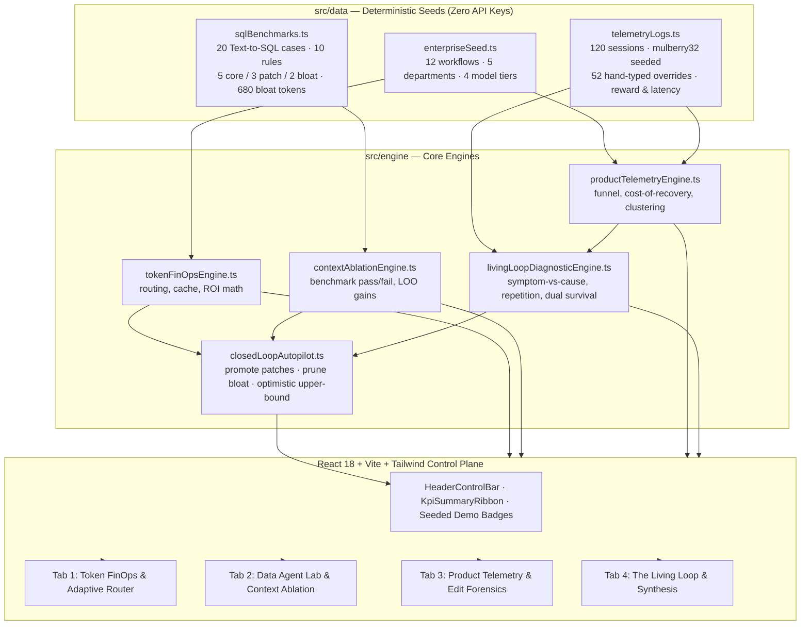
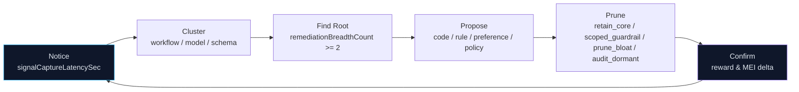

# AegisLoop — AI FinOps, Self-Healing Context, Product Telemetry & The Living Loop

> **Prototype Status:** Offline, deterministic simulation of an enterprise AI optimization control plane. Zero API keys, zero GPU, zero network calls. All metrics below are simulated.

<p align="center">
  
</p>

## Table of Contents
- [What Problem AegisLoop Addresses](#what-problem-aegisloop-addresses)
- [Why Separate Tools Fall Short](#why-separate-tools-fall-short)
- [The Four Pillars at a Glance](#the-four-pillars-at-a-glance)
- [Architecture](#architecture)
- [Simulated Benchmark Results](#simulated-benchmark-results)
- [Pillar 1 — Token FinOps & ROI-Aware Routing](#pillar-1--token-finops--roi-aware-routing)
- [Pillar 2 — Data Analyst AI Agent & Context Ablation](#pillar-2--data-analyst-ai-agent--context-ablation)
- [Pillar 3 — AI Product Telemetry & Edit Forensics](#pillar-3--ai-product-telemetry--edit-forensics)
- [Pillar 4 — The Living Loop](#pillar-4--the-living-loop)
- [The Math Under the Hood](#the-math-under-the-hood)
- [Dashboard — Four Tabs](#dashboard--four-tabs)
- [Quickstart & Reproducibility](#quickstart--reproducibility)
- [Repository Structure](#repository-structure)
- [Honest Limitations, Why I Refuse to Score People & What's Next](#honest-limitations-why-i-refuse-to-score-people--whats-next)

## What Problem AegisLoop Addresses

Most teams trying to get their arms around enterprise AI treat it as three separate problems owned by three different groups:

1. **FinOps** builds a token dashboard to figure out why the monthly API bill is on fire.
2. **Data & AI Engineering** stuffs business rules and table schemas into a Text-to-SQL agent and hopes accuracy goes up.
3. **Product Analytics** tracks how often users edit, regenerate, or abandon AI outputs.

When I looked at those three pieces, it hit me that they aren't three separate projects — they're three chapters of the same headache. If your AI bill is exploding, it's usually because users keep hitting "regenerate" and rewriting bad outputs, and they're rewriting those outputs because the agent is missing the right business rules and schema context.

AegisLoop is my attempt to wire all three into a single closed loop. It is an interactive, offline, deterministic simulation that connects:

- **Token spend and value** — what it costs and what it's worth
- **Context quality** — which rules actually help
- **Correction effort** — how much humans still have to fix

Poor context → incorrect answers → edits / regenerations → increased cost. The loop makes that visible and testable.

> **An upfront honesty note on the numbers:** Every figure in this repo — the 83.2% drop in monthly token spend, the 35% → 95% SQL accuracy jump, and the 160.8 → 22.5 drop in Manual Effort Index — comes from a deterministic **simulated enterprise benchmark dataset** I seeded so you can clone this repo and run the entire control plane locally with zero API keys. Treat them as a reproducible testbench showing how the loop behaves, not a live production billing statement. See [Honest Limitations](#honest-limitations-why-i-refuse-to-score-people--whats-next).

## Why Separate Tools Fall Short

FinOps dashboards track spend but not *why* spend recurs. Prompt-engineering tools measure token length but not marginal accuracy per token. Product analytics track clicks but not the dollar cost of retry loops.

Viewed separately, you can cut cost but hurt accuracy, or add context but inflate overhead. AegisLoop treats cost, context quality, and correction effort as one system so a fix in one layer can be evaluated against its impact on the others.

## The Four Pillars at a Glance

| Step | Pillar | Role in the System | How I Approached It |
| :--- | :--- | :--- | :--- |
| 1 | Token FinOps & ROI-Aware Routing | Technical mechanism | Connects team token spend to actual verified outcomes, then routes low-complexity prompts off expensive frontier models onto quantized 8B models and a semantic cache. |
| 2 | Data Analyst AI Agent & Context Ablation | Technical mechanism | Feeds business rules into a Text-to-SQL agent and uses leave-one-out Shapley ablation to measure how much accuracy each rule actually buys per 100 tokens. |
| 3 | AI Product Telemetry & Edit Forensics | Technical mechanism | Tracks how often humans have to edit, regenerate, or abandon AI outputs, and puts a hard dollar figure on the tokens burned inside retry loops. |
| 4 | **The Living Loop — Diagnostic & Remedy Framework** | Diagnostic philosophy (My Addition) | My own diagnostic layer: a systems method to diagnose *new* failure modes, separate one person's style quirk from a company-wide bug, and keep human accountability with humans. |

My central insight is that AI costs, output quality, and repeated user corrections are connected. I built The Living Loop as my diagnostic contribution to connect these signals and recommend whether a problem needs a code fix, a context-rule change, a scoped preference, or human policy intervention.

## Architecture

### System Architecture — GitHub Native Mermaid



### The Living Loop — Six-Stage Diagnostic Cycle



### Visual Overview

[AegisLoop Architecture](./assets/architecture.png)

**Data flow:** Seed data flows upward, diagnostics flow downward. Deterministic, auditable, observable.

## Simulated Benchmark Results

> **All numbers below are simulated.** They come from a deterministic, seeded enterprise benchmark dataset created for local reproducibility. They are not live production measurements, independent validation, or evidence of guaranteed real-world savings.

The autopilot in `closedLoopAutopilot.ts` uses an optimistic assumption: when a context rule is promoted, the simulation treats it as resolving every simulated session in its mapped failure category. `simulateTelemetryAfterAutopilot` therefore models an **upper bound**, not a demonstrated production outcome.

| Metric | Baseline | Simulated Optimized Result |
| :--- | :--- | :--- |
| Monthly token spend | $12,937.96 | $2,179.27, down 83.2% |
| SQL benchmark accuracy | 35% raw; 70% with static context | 95% |
| Prompt overhead | 930 tokens/query | 435 tokens/query |
| Manual Effort Index | 160.8 | 22.5, approximately 86% lower |
| Average reward score | 0.65 | 0.91 |
| Full-reward share | 41.7% | 85.0% |
| Edit rate | 58.3% | 15.0% |
| Regeneration rate | 55.0% | 11.7% |
| Cost per accepted output | $0.612 | $0.280 |
| Net ROI multiplier | ×151.1 | ×902.1 |
| Annualized modeled savings | — | $129,467 |

Annualized = (FinOps routing savings + recovered retry-loop spend) × 12

## Pillar 1 — Token FinOps & ROI-Aware Routing

Technical mechanism to answer where money goes and why.

- **Modeled spend & value:** 12 enterprise workflows, each with outcomes, hours saved, loaded wage, direct revenue.
- **ROI-aware routing by complexity:**
  - `complexity < flashThreshold` → quantized 8B
  - `complexity < frontierThreshold` → Flash
  - Otherwise → frontier model
- **Adjustable thresholds** in the UI with automatic cross-clamping — you cannot invert tiers.
- **Semantic caching:** Modeled billed volume drops by `hitPotential × 0.85`. Heuristic, not measured cache.
- **Prompt-bloat pruning toggle:** Models 680-token pruning from bloat rules.
- **Routing ledger:** 12-workload ledger showing which Frontier workloads get demoted.

**Modeled pricing assumptions — simulation only, not universal provider prices:**

- Frontier pricing: $15 / $60 per million tokens
- Cache lookup pricing: $0.10 per million lookups

This is the difference between modeled savings and measured production savings. The prototype does not connect to live billing.

## Pillar 2 — Data Analyst AI Agent & Context Ablation

Which context actually helps?

- **20 Text-to-SQL cases** in `sqlBenchmarks.ts`, **10 rules:** 5 core, 3 patch, 2 bloat.
- Each case explicitly declares `requiredRuleIds`. Simplification for deterministic ablation — does not prove generalization to unseen SQL.
- **Toggles:** Turn any of 10 rules on/off and watch simulated accuracy (35% → 70% → 95%) and token overhead recompute live.
- **Leave-one-out Shapley efficiency:** `efficiencyPer100Tokens = marginalAccuracyGain / tokenWeight × 100`
- **Structural survival verdicts:** `retain_core`, `audit_dormant`, `scoped_guardrail`, `prune_bloat`
- **Diff inspector:** 20-case SQL diffs, including `sql_020` which I intentionally left open for iteration 2 so the loop doesn't pretend to hit a fake 100%.

**Limitation:** `RULE_HINT_KEYWORDS` uses deterministic keyword matching, not semantic embeddings.

## Pillar 3 — AI Product Telemetry & Edit Forensics

How humans actually interact with outputs.

- **120 seeded sessions** (mulberry32), **52 hand-typed instruction events**
- **Signals:** Acceptance, editing, regeneration, abandonment, manual overrides
- **Costs:** Productive vs wasted modeled spend — tokens burned inside retry loops
- **Latency:** `signalCaptureLatencySec` — gap between wrong output and captured correction
- **Diffs:** Side-by-side agent-vs-human edit diffs, surface-by-surface breakdown, high-friction session log

These are not real users or production logs — seeded scenarios to test diagnostic logic.

## Pillar 4 — The Living Loop

My addition. Steps 1-3 are the technical "how." Step 4 is the diagnostic "why and when."

Right after I got the first three steps working, I hit the real wall: **the system only knew how to fix the two or three failure modes I had already anticipated.** In a real company, new schemas and edge cases break next Tuesday. How do you diagnose unseen problems as they show up — and decide whether the fix belongs in code, prompt context, or human policy — without turning AI logs into creepy employee surveillance?

### What Step 4 adds:

- **Speed (signal freshness):** A mistake only teaches while its context is still warm. Every session tracks `signalCaptureLatencySec`.
- **Reward, not pain:** An AI doesn't have a body, so pain or punishment is the wrong mental model. Instead: *was the output good, full, and complete?* That maps to `R ∈ [0, 1]` — `1.0` accepted, `1.0 − editDistance` edited, `0.0` abandoned. Modeled signal, not complete quality measure.
- **Multi-function growth (two-factor rule survival):** A rule only earns permanent residency in global prompt if it helps across ≥2 templates — unless it's a strict factual guardrail (like fiscal year starts Feb 1). Pairing structural check with empirical Shapley gives two defenses against bloat: `retain_core`, `audit_dormant`, `scoped_guardrail`, `prune_bloat`.
- **Symptom-vs-cause diagnosis:** Hardcoding one Q1 revenue number fixes a symptom. Adding fiscal calendar + currency-join conventions as one rule fixes the cause. Rule: cause-level fix prevents ≥2 distinct correction patterns (`remediationBreadthCount >= 2`).
- **The 10× repetition trigger:** When someone types same guardrail by hand ≥10 times, system notices.
  - 12× from one user (e.g., lowercase SQL aliases) → save to **personal profile memory**, don't pollute global prompt
  - 13× across multiple users (≥3 people same workaround) → escalate as **org-wide context patch candidate**
  - 6× pattern → stays quiet below threshold
  - These are heuristics, not scientifically validated universal rules
- **Manual Effort Index as headline metric:** Accuracy looks great in a notebook, but in production nobody has ground-truth for every ad-hoc question. So: `MEI = (manualEdits + regenerations + handTypedOverrides) / sessions × 100`. Baseline 160.8 → 22.5 simulated.
- **Humans own outcomes (two layers, zero surveillance):**
  - **Software Layer:** catches edits, clusters retries, prunes dead rules
  - **Human Policy Layer:** handles silent dissatisfaction via quick end-of-session check *"Was this good, full, and complete?"*
  - **Non-Surveillance Principle:** AegisLoop must not score, rank, or judge employees. Aggregation by AI workflow, model tier, and table schema — never employee identity. Employee scoring would make people accept bad outputs to protect metrics, destroying the correction signal.

## The Math Under the Hood

Exact, division-safe, test-locked formulas preserved from implementation:

```text
grossValueUsd = outcomes × hoursSaved × loadedWage + directRevenue
netRoiRatio = (grossValue - spend) / max(spend, 0.01)
costPerVerifiedOutcome = spend / max(1, outcomes)

Routing:
complexity < flashThreshold      → quantized 8B
complexity < frontierThreshold   → Flash
otherwise                       → frontier model  ($15/$60 per 1M tokens)

Cache:
billedVolumeReduction = hitPotential × 0.85
lookupPrice = $0.10 per million lookups

Context Efficiency:
efficiencyPer100Tokens = marginalAccuracyGain / tokenWeight × 100

MEI = (manualEdits + regenerations + handTypedOverrides) / sessions × 100

Reward:
Accepted:  R = 1.0
Edited:    R = 1.0 - editDistance
Abandoned: R = 0.0

Annualized = (FinOps routing savings + recovered retry-loop spend) × 12
```

Interpretation of edit distance, ROI, and reward depends on data contracts in `types/aegis.ts`.

## Dashboard — Four Tabs

**1. Token FinOps & Adaptive Router (Step 1)** — Drag complexity-threshold sliders (with automatic cross-clamping), flip semantic cache and bloat-pruning toggles, inspect 12-workload routing ledger.

**2. Data Agent Lab & Context Ablation (Step 2)** — Toggle any of 10 context rules and watch SQL accuracy (35% → 70% → 95%) and token overhead recompute live. Shows empirical LOO Shapley efficiency + Step 4 structural verdicts + 20-case SQL diff inspector. `sql_020` intentionally left unresolved.

**3. Product Telemetry & Edit Forensics (Step 3)** — 120 sessions into acceptance funnel, productive-vs-wasted waterfall, surface-by-surface table, agent-vs-human edit diffs, top high-friction sessions.

**4. The Living Loop & Synthesis (Step 4)** — Walks through 6-step cycle `Notice → Cluster → Find Root → Propose → Prune → Confirm` with live numbers, **Repetition Trigger & Preference Filter table** (12× single-user → personal memory, 13× multi-user → global patch, 6× → below threshold), **Two-Layer Governance panel**, **Non-Surveillance Ethics Pledge**, and one-click case-study export.

## Quickstart & Reproducibility

```bash
npm install
npm run dev      # launch the interactive control plane → http://localhost:5173
npm test         # run all 39 deterministic engine assertions (vitest)
npm run build    # strict type-check (tsc --noEmit) + production Vite bundle
```

- **Seeded dataset:** 12 workflows, 5 departments, 4 model tiers, 20 Text-to-SQL cases, 10 rules (5 core / 3 patch / 2 bloat, 680 bloat tokens), 120 sessions, 52 hand-typed overrides, `mulberry32` randomness
- **Zero** API keys, zero GPU, zero network calls at runtime
- Consult `package.json` for runtime requirements — no Node version invented here

## Repository Structure

```text
aegis-loop/
├── LICENSE
├── README.md
├── assets/
│   └── architecture.png
├── package.json
├── tsconfig.json
├── vite.config.ts
├── tailwind.config.js
├── postcss.config.js
├── index.html
├── src/
│   ├── main.tsx
│   ├── App.tsx
│   ├── index.css
│   ├── types/
│   │   └── aegis.ts            # locked data contracts incl. Living Loop types
│   ├── utils/
│   │   └── format.ts
│   ├── data/
│   │   ├── enterpriseSeed.ts
│   │   ├── sqlBenchmarks.ts
│   │   └── telemetryLogs.ts
│   ├── engine/
│   │   ├── tokenFinOpsEngine.ts
│   │   ├── contextAblationEngine.ts
│   │   ├── productTelemetryEngine.ts
│   │   ├── livingLoopDiagnosticEngine.ts
│   │   └── closedLoopAutopilot.ts
│   └── components/
│       ├── HeaderControlBar
│       ├── KpiSummaryRibbon
│       └── Tab1–Tab4
└── tests/
    └── aegisEngine.test.ts     # 39 deterministic assertions across all 4 steps
```

Documented structure, not independently verified listing.

## Honest Limitations, Why I Refuse to Score People & What's Next

- **Simulated, not production:** Every financial and accuracy number comes from deterministic seeded dataset for offline reproducibility. Do not cite as live production. Verification so far self-run via 39 Vitest assertions, not blind third-party review.
- **Full-resolution & keyword-matching assumptions:** `simulateTelemetryAfterAutopilot` models optimistic upper bound where promoting a context rule fully resolves every session in its mapped failure category into clean first-try acceptance (why MEI drops 86% from 160.8 to 22.5 and cost per accepted drops $0.612 → $0.280). Benchmark cases explicitly declare `requiredRuleIds`, and `RULE_HINT_KEYWORDS` matches via deterministic keywords rather than semantic embeddings.
- **Why I refuse to score individuals:** Telemetry aggregates strictly by **AI workflow, model tier, and table schema** — never by employee identity. The moment a company uses edit logs or retry counts to grade employees, people stop fixing hallucinated outputs and start clicking "accept" on garbage to protect metrics. Managing people belongs with human managers, not a token dashboard.
- **How I plan to validate in real world:**
  1. Run Step 2 + Step 4 ablation and self-healing loop against public execution-based Text-to-SQL benchmarks (**BIRD-SQL** and **Spider 2.0**) with live models
  2. Test telemetry package with 1–2 design partners on anonymized logs
  3. Package a 7-day **AI Waste Audit** — one week of logs to map token spend, accuracy leakage, root causes vs personal preferences, and dead-weight prompt rules ready to prune

These are planned activities, not completed work.

## Contributing & License

Contributions welcome for simulation fidelity, benchmark adapters, Living Loop heuristics. Open an issue before changing metrics/formulas/honesty constraints. No real user data or credentials — keep offline & deterministic.

`LICENSE` file presence does not establish its terms — consult the file directly for license type.
